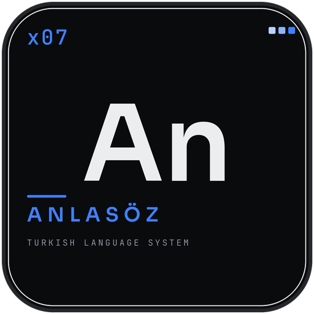
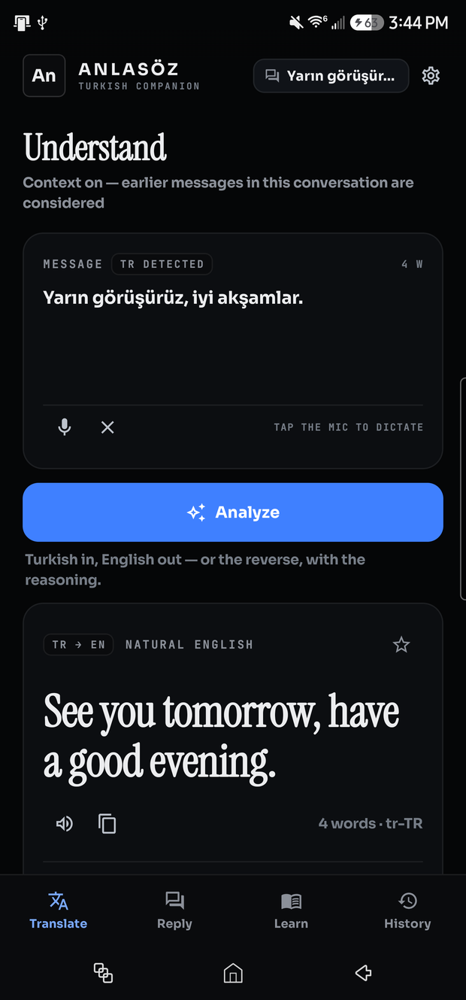
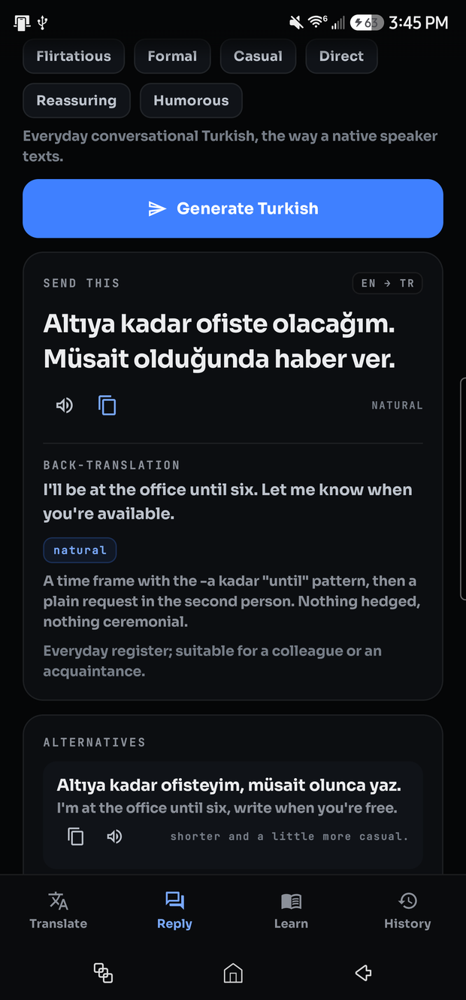
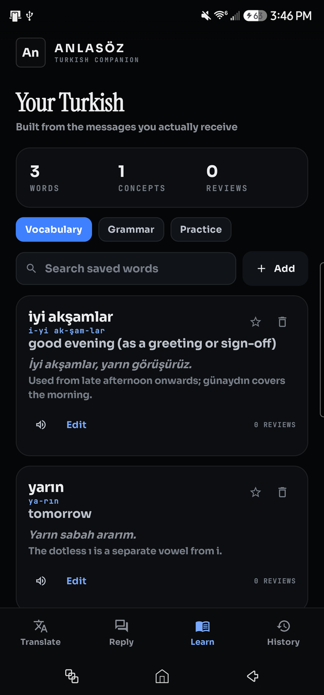
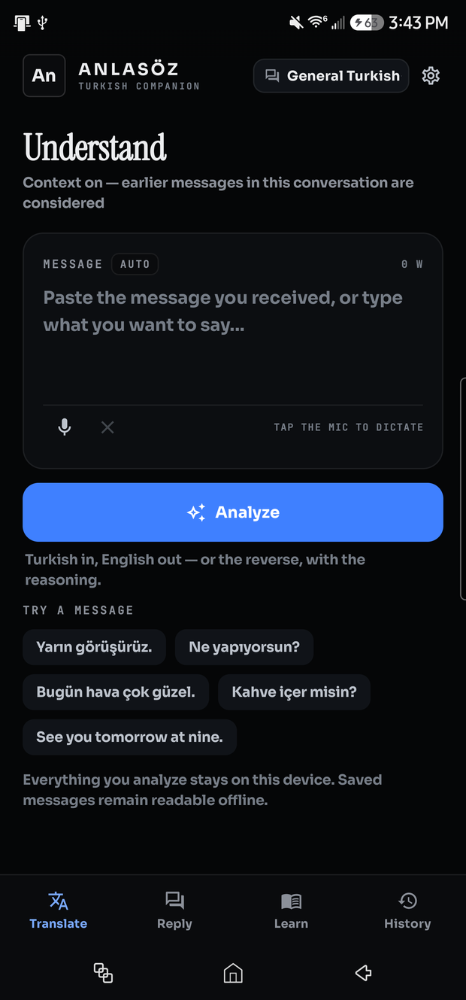
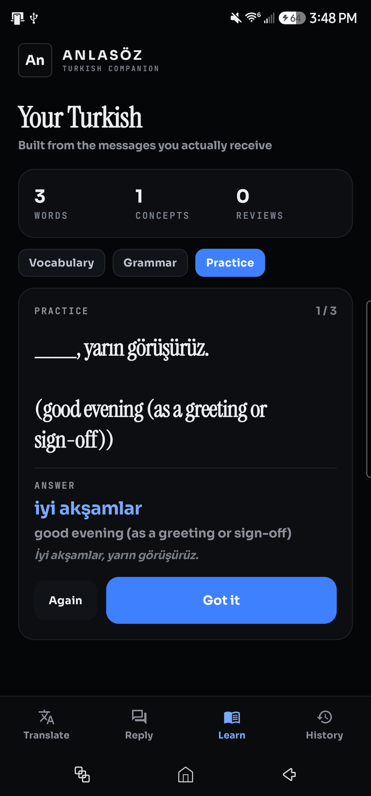
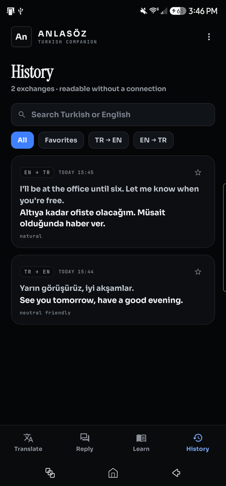
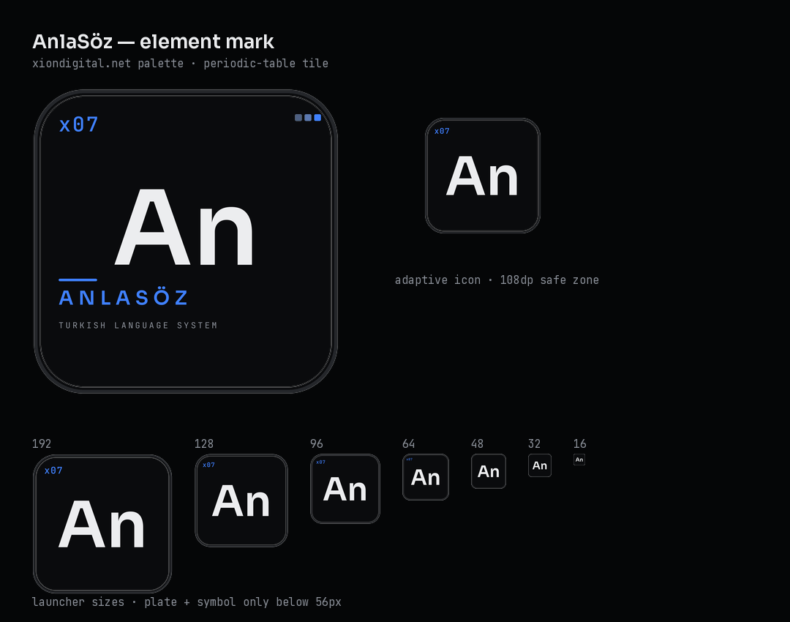
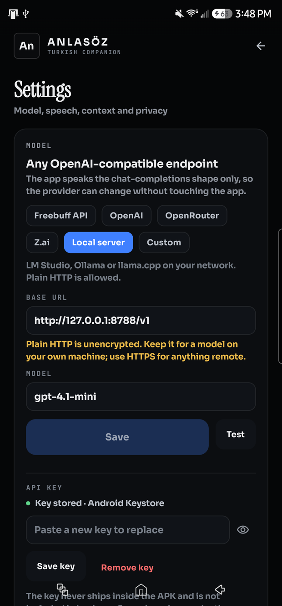

# AnlaSöz

<p align="center">
  
</p>

<p align="center">
  <strong>Turkish ↔ English, explained — not just translated.</strong><br />
  A native Android companion for the messages you actually receive: what they mean, why they mean it, how the sentence is built, how it sounds, and how to answer.
</p>

<p align="center">
  
  
  
  
</p>

<p align="center">
  
  
  
</p>

<p align="center">
  <a href="https://github.com/XiONDiGiTaL/anlasoz/releases/latest"><strong>↓ Download the signed APK (1.0.0)</strong></a>
  <br />
  <sub>Android 8.0+ · installs alongside a debug build · set your own endpoint and key on first launch</sub>
</p>

---

## Contents

- [Why this exists](#why-this-exists)
- [The four screens](#the-four-screens)
- [How the language layer works](#how-the-language-layer-works)
- [Speech](#speech)
- [Data, offline behaviour and privacy](#data-offline-behaviour-and-privacy)
- [Design system](#design-system)
- [Getting started](#getting-started)
- [Configuring the model](#configuring-the-model)
- [Building and signing](#building-and-signing)
- [Testing](#testing)
- [Project layout](#project-layout)
- [Limitations and next steps](#limitations-and-next-steps)

---

## Why this exists

Machine translation answers "what does this sentence say". That is rarely the whole question with a Turkish message. A two-word reply like *"Ben de"* means "me too" only if you know what came before it. *"Ya"* at the end of a sentence is not a word you can look up. A message can be warm, clipped, ironic or simply tired, and the difference lives in particles, suffixes and word order rather than in vocabulary.

AnlaSöz is built around that gap:

- **Meaning first.** The headline is a natural English sentence, not a word-for-word rendering. The literal structure, tone and grammar sit underneath it, closed until you want them.
- **Context is carried.** Messages belong to conversation threads; earlier turns in the active thread travel with a new message so pronouns, short answers and replies make sense.
- **It teaches the sentence you just received.** Vocabulary, suffixes and patterns are saved from real messages and turned into a review deck, instead of generic lessons.
- **It answers back.** English in, natural Turkish out, with a back-translation you can check before sending.
- **It hears it.** Every Turkish sentence can be spoken by the device's own `tr-TR` voice.
- **It stays yours.** One key you own, stored in the Android Keystore, no analytics, no telemetry, history on the device.

---

## The four screens

<table>
<tr>
<td width="50%" valign="top">

### Translate

Paste, dictate or share a message into the app. Direction is detected automatically: Turkish gets an English reading, English gets Turkish plus suggested replies.

The result is one card that leads with the natural translation, then unfolds into literal structure, contextual interpretation, tone, sentence breakdown, grammar, vocabulary, alternative readings and confidence notes. Sections with nothing useful to say are not shown.

Per-word saves drop straight into Learn; the star keeps an exchange in Favorites; the speaker reads the Turkish aloud.

</td>
<td width="50%" valign="top">



</td>
</tr>
</table>

<p align="center">
  
</p>

**Details that matter**

- Word count and detected language are live while you type; the label stays honest ("AUTO") until detection is confident.
- Long messages scroll inside the input, so the Analyze action never moves away.
- Sharing text from any app (or selecting it and choosing *AnlaSöz* in the text menu) opens the app and analyzes immediately.
- A failed request keeps your text, says what failed, and offers one retry — it never substitutes a made-up result.
- TTS speed and auto-play are settings; the playback controls appear while speech is running.

<br />

<table>
<tr>
<td width="50%" valign="top">

### Reply

Write the meaning in English and pick a register. Ten tones, from *Natural* (the default) to *Formal*, *Casual*, *Direct*, *Reassuring* and others.

The result is Turkish a person would actually send, with an English back-translation so you can verify it before pasting, plus one to three alternatives that shift the nuance rather than repeat it.

The copy button copies **only** the Turkish sentence — no labels, no explanation, no markdown.

</td>
<td width="50%" valign="top">


</td>
</tr>
</table>

<br />

<table>
<tr>
<td width="50%" valign="top">

### Learn

Everything saved from real messages: Turkish, meaning, syllable pronunciation, an example sentence, a usage note and an optional grammar note. Words can be added or edited by hand too.

Three views: **Vocabulary** (searchable list), **Grammar** (notes captured from analyses) and **Practice** — a cloze deck built from your own saved words, with "Again" / "Got it" grading and a review counter.

</td>
<td width="50%" valign="top">



</td>
</tr>
</table>

<br />

<table>
<tr>
<td width="50%" valign="top">

### History

Every exchange, searchable in both languages, filterable by direction, favorites and conversation, starrable, deletable one at a time or all at once, and exportable.

Tapping a row opens the full analysis again — including the vocabulary save actions — so a message you analyzed last week is still a lesson today.

There is an overflow menu for export and destructive actions; clearing history never touches saved vocabulary or grammar notes.

</td>
<td width="50%" valign="top">



</td>
</tr>
</table>

---

## How the language layer works

The app speaks exactly one protocol: **OpenAI chat completions**. There is no provider SDK, no vendor lock-in and no server of its own. Base URL, model name and key are configuration; anything that accepts the chat-completions shape — a hosted model, OpenRouter, Z.ai, Freebuff's developer endpoint, LM Studio, Ollama, llama.cpp, or your own proxy — can back the app.

```
ui/translate · ui/reply  →  TranslationRepository  →  AiClient (OkHttp)
                                   │                        │
                                   │                        └── POST {baseUrl}/chat/completions
                                   ├── Prompts (system + user, JSON schema)
                                   ├── AnalysisParser (tolerant, one repair round)
                                   └── Room (messages, vocabulary, notes, threads)
```

- **Structured output.** Analysis requests ask for JSON in a fixed shape (`detected_language`, `natural_translation`, `literal_translation`, `contextual_interpretation`, `tone`, `sentence_breakdown`, `grammar_notes`, `vocabulary`, `alternative_interpretations`, `suggested_replies`, `confidence_notes`). The user never sees raw JSON: the parser fills a typed model and the UI renders only non-empty sections.
- **Prompted as a teacher, not a translator.** The system prompt asks for natural English, a literal gloss, an explanation of particles and suffixes, alternatives when a message is genuinely ambiguous, and an explicit refusal to invent hidden intentions. Tone is described as *plausible from the wording*, not as a fact about the sender.
- **Repair, then fail.** A malformed response gets one automatic repair pass. If it still does not parse, the user sees a plain-language failure with a retry, and the input is preserved. Nothing is fabricated.
- **Context assembly.** The repository sends the last few messages of the active thread (bounded, user-toggleable) plus any manual context, so *"Ben de"* is read against what it answers.
- **Failure taxonomy.** No key, not configured, unauthorized, rate-limited, timeout, offline, malformed — each maps to a specific message and a next step, rather than a stack trace.
- **Speech is optional.** Typing never depends on a microphone; a device without a Turkish voice still gets every text feature plus a clear notice when you ask it to speak.

---

## Speech

- **Text-to-speech** uses the platform engine with `tr-TR` for Turkish and English voices for English. A real Turkish voice is required: if the device has none, the app says so and offers the system voice settings instead of reading Turkish with an English voice.
- **Playback controls** appear during speech — stop is always available, pause/resume where the engine supports it — and speed is adjustable in Settings.
- **Speech-to-text** uses `SpeechRecognizer` with `tr-TR` or `en-US` depending on the screen, requests the microphone permission at the moment you tap it, shows a listening state, stops on its own when recognition ends, and drops the transcript into the input for editing before anything is sent.
- Nothing records in the background and no audio is retained.

---

## Data, offline behaviour and privacy

| What | Where | Survives restart | Leaves the device |
| --- | --- | --- | --- |
| Messages, analyses, replies | Room (`anlasoz.db`) | yes | only in the model request that created them |
| Vocabulary, grammar notes | Room | yes | no |
| Provider key | `EncryptedSharedPreferences` (Android Keystore) | yes | only as an `Authorization` header |
| Base URL, model, speech and context preferences | DataStore | yes | no |
| Exports | app cache → share sheet | until cleared | only when you share them |

- No analytics, crash reporting, ads or third-party SDKs. The dependency list is Compose, Room, DataStore, security-crypto, OkHttp, kotlinx-serialization and coroutines.
- `allowBackup="false"`, with explicit cloud-backup and device-transfer exclusions for the database, the secure preferences and DataStore.
- Message content is never logged; the debug build logs failures only.
- History, individual exchanges, vocabulary and conversations are deleted immediately and locally.
- **The key belongs to you, not to the app.** Settings warns whenever a plain-HTTP base URL is configured, because remote traffic should be HTTPS. For a build distributed to other people, put a small server-side proxy in front of the provider and point the base URL at it — the app needs nothing more than a URL.

---

## Design system

The palette is the one `xiondigital.net` ships, read from the site's tokens instead of approximated. The site is a single dark editorial theme, so AnlaSöz does not invent a light variant.

| Token | Value | Use |
| --- | --- | --- |
| `bg` | `#050607` | page background |
| `bgRaised` | `#0A0B0D` | app bar, element tile |
| `panel` | `#0C0E11` | cards |
| `panelHi` | `#101318` | inputs, chips |
| `line` | `rgba(255,255,255,0.07)` | hairlines |
| `ink` | `#ECEDEF` | primary text |
| `body` | `#BDC3CC` | body copy |
| `muted` | `#8B9099` | secondary text |
| `blue` | `#3F80FF` | primary action |
| `blueHi` | `#79A8FF` | links, active icons |

Sora carries the interface; a serif display face is reserved for screen titles and translated sentences, so the answer reads like a quotation rather than a table cell; a mono face handles the small uppercase instrument labels (`TR → EN`, `NATURAL ENGLISH`, counts). Corners stay between 12 and 20 dp, spacing is on a 4 dp grid, and motion is limited to fades and the analysis skeleton.

The mark is an element tile — `An`, atomic number `x07`, plate and symbol — with an adaptive launcher icon at every density:

<p align="center">
  
</p>

Settings is the fifth surface behind the gear icon:

<p align="center">
  
</p>

---

## Getting started

**Install** — download `anlasoz-1.0.0-release.apk` from [Releases](https://github.com/XiONDiGiTaL/anlasoz/releases/latest), allow installation from your file manager if Android asks, then open **Settings** and add your endpoint, model and key. The app ships with no credentials and no default provider.

**Requirements** — Android Studio Ladybug or newer (or a JDK 17 command line), Android SDK platform 36, and a device or emulator on Android 8.0 (API 26) or newer. The project builds with Gradle 8.13, AGP 8.9.2, Kotlin 2.1.20 and the Compose BOM 2025.05.01.

```bash
git clone https://github.com/XiONDiGiTaL/anlasoz.git
cd anlasoz

./gradlew assembleDebug      # app/build/outputs/apk/debug/app-debug.apk
./gradlew installDebug       # or: adb install -r app/build/outputs/apk/debug/app-debug.apk
```

Open the folder in Android Studio and press Run if you prefer. `local.properties` is generated by the IDE and is not tracked.

---

## Configuring the model

Settings → **Model**. One configuration powers translation, interpretation and reply generation.

| Preset | Base URL | Notes |
| --- | --- | --- |
| Freebuff API | `https://freebuff.com/api/v1/paid` | enter the model name shown for your plan |
| OpenAI | `https://api.openai.com/v1` | a key from platform.openai.com |
| OpenRouter | `https://openrouter.ai/api/v1` | one key, model names as `vendor/model` |
| Z.ai | `https://api.z.ai/api/paas/v4` | GLM models |
| Local server | `http://192.168.1.10:1234/v1` | LM Studio, Ollama, llama.cpp |
| Custom | anything | your own proxy or gateway |

1. Choose a preset or **Custom** and set the base URL. The app appends `/chat/completions`, so a URL ending in `/v1` is correct.
2. Set the model name.
3. Paste the key and tap **Save key** — it goes to the Android Keystore and is never written to source, resources, logs or backups.
4. **Test** sends a tiny probe and shows what the endpoint answered; failures name the problem (bad key, bad URL, timeout, malformed answer).

Plain HTTP is permitted so a model on your own machine works; Settings flags every `http://` endpoint for that reason.

---

## Building and signing

A release build enables R8 and resource shrinking:

```bash
./gradlew assembleRelease     # app/build/outputs/apk/release/app-release-unsigned.apk
```

Sign it with your own key — `keys/`, `*.jks` and `*.keystore` are git-ignored:

```bash
keytool -genkeypair -v -keystore keys/release.jks -alias anlasoz \
        -keyalg RSA -keysize 2048 -validity 10000

$ANDROID_HOME/build-tools/<version>/apksigner sign \
        --ks keys/release.jks \
        --out anlasoz-1.0.0-release.apk \
        app/build/outputs/apk/release/app-release-unsigned.apk
```

Versioning lives in `app/build.gradle.kts` (`versionCode` / `versionName`); bump both for each published build. The debug variant installs alongside as `net.xiondigital.anlasoz.debug`, so a release build does not replace your test install.

---

## Testing

```bash
./gradlew test                      # JVM unit tests
./gradlew connectedDebugAndroidTest # Room tests on a device or emulator
./gradlew lintDebug                 # Android lint
```

| Suite | Covers |
| --- | --- |
| `MapperAndParserTest` | analysis JSON parsing, partial and malformed payloads, the Room mapper round-trip that once silently dropped structured lists |
| `TurkishTextTest` | language detection and Turkish-aware word counting (`ı`, `ç`, `ğ`, `ö`, `ş`, `ü`) |
| `AnalysisDaoTest` | the Translate feed excludes reply drafts while the thread keeps them |

Lint reports 0 errors. The remaining warnings are resource-cleanup suggestions, one newer test dependency, and the deliberate cleartext allowance for local models.

**Manual verification** on a Galaxy S23 Ultra: analysis round trip and persistence across restart, error and retry with input preserved, copy-to-clipboard, Turkish TTS with a real `tr-TR` voice, microphone permission and live recognition, vocabulary saving from an analysis and from history, practice grading, JSON export through the share sheet, large font scale, landscape, and the signed, minified release build that ships in Releases — configured against the same endpoint and confirmed to parse and render an analysis end to end.

The screenshots in `docs/` come from the debug build against a deterministic local endpoint; the text shown is sample content, not a real conversation.

---

## Project layout

```
anlasoz/
├── app/src/main/java/net/xiondigital/anlasoz/
│   ├── ai/         AiClient, prompts, parser, presets, failure types
│   ├── audio/      SpeechController (TTS), SttController (SpeechRecognizer)
│   ├── core/       TurkishText, PracticeBuilder
│   ├── data/       db (entities, DAOs, mappers), repo, prefs, export
│   ├── ui/         theme, components, translate, reply, learn, history, settings
│   ├── AppContainer.kt      manual dependency graph
│   └── MainActivity.kt      share / process-text entry points
├── app/src/test/            JVM tests
├── app/src/androidTest/     Room tests
├── docs/                    screenshots and brand sheet
└── app/schemas/             exported Room schema
```

MVVM with `StateFlow`; one `app` module, package boundaries as the seams to split on if it grows. Compose only, no XML layouts beyond resources. The network layer is a single OkHttp call behind `AiClient`, which is what makes swapping providers a settings change rather than a refactor.

---

## Limitations and next steps

- **Speech depends on the device.** Recognition needs a recognition service, and Turkish TTS needs a `tr-TR` voice; both are reported rather than faked.
- **No server component ships here.** Distributing the app means adding the proxy described above.
- **Tone labels are guidance.** A prompt steers the register; it is not a guarantee, and the back-translation is there so you can judge.
- **Ambiguity is surfaced, not resolved.** When a message could mean two things, both readings are shown — the app will not pretend to know the relationship behind them.
- **Possible next steps:** sentence-by-sentence playback for long messages, an in-app export browser, and a thin server example for shared deployments.

---

<p align="center">
  <sub>AnlaSöz — built for XiØN · <a href="https://xiondigital.net">xiondigital.net</a> · © 2026. No license is granted for redistribution.</sub>
</p>
